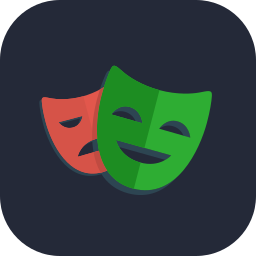

  

  

  
  
  
  

---

## Sobre mim

Trabalho com tecnologia há quase **10 anos**. Passei por **suporte técnico** e **implantação de sistemas** antes de chegar ao **QA**, onde atuo desde novembro de 2025 como **Software Quality Analyst III na [Senior Sistemas](https://www.senior.com.br/)**, garantindo a qualidade das soluções **HCM do Senior X**.

Esse caminho faz diferença no meu dia a dia: entender como o sistema funciona de verdade, e pelo lado de quem usa, muda a forma de analisar requisitos, desenhar cenários de teste e antecipar falhas.

- Planejo, defino e executo cenários de teste, e venho evoluindo a automação com **Playwright + TypeScript**
- Analiso integrações entre aplicações, produtos e sistemas
- Acredito que qualidade é construída em conjunto por desenvolvimento, produto e negócio
- Bacharel em Sistemas de Informação, pós-graduado em Gestão de Projetos de TI e Metodologias Ágeis

<b>English</b>

 

I have been working in technology for almost **10 years**. I went through **technical support** and **systems implementation** before moving into **QA**, where I have worked since November 2025 as a **Software Quality Analyst III at [Senior Sistemas](https://www.senior.com.br/)**, ensuring the quality of the **Senior X HCM solutions**.

This background shapes my daily work: understanding how the system really works, from the user's point of view, changes the way I analyze requirements, design test scenarios and anticipate failures.

- I plan, define and run test scenarios, and I have been growing my test automation skills with **Playwright + TypeScript**
- I analyze integrations between applications, products and systems
- I believe quality is built together by development, product and business
- Bachelor's degree in Information Systems, postgraduate degree in IT Project Management and Agile Methodologies

<b>Español</b>

 

Trabajo en tecnología hace casi **10 años**. Pasé por **soporte técnico** e **implementación de sistemas** antes de llegar a **QA**, donde trabajo desde noviembre de 2025 como **Software Quality Analyst III en [Senior Sistemas](https://www.senior.com.br/)**, asegurando la calidad de las soluciones **HCM de Senior X**.

Esta trayectoria marca la diferencia en mi día a día: entender cómo funciona el sistema de verdad, desde el lado de quien lo usa, cambia la forma de analizar requisitos, diseñar escenarios de prueba y anticipar fallas.

- Planifico, defino y ejecuto escenarios de prueba, y vengo desarrollando la automatización con **Playwright + TypeScript**
- Analizo integraciones entre aplicaciones, productos y sistemas
- Creo que la calidad se construye en conjunto entre desarrollo, producto y negocio
- Licenciado en Sistemas de Información, con posgrado en Gestión de Proyectos de TI y Metodologías Ágiles

---

## Stack e ferramentas

  
  
  
  
  
  
  
  
  

**Testes:** testes manuais · automação E2E e de API · análise de requisitos · planejamento de testes · Page Objects  
**Processos:** Scrum e metodologias ágeis · gestão de projetos · documentação técnica · análise de processos

  

